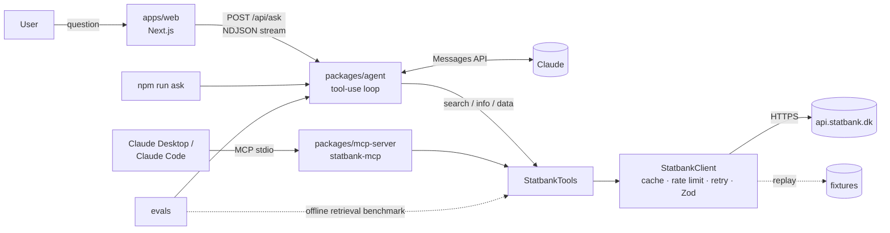

# Spørg Danmarks Statistik

**Ask Statistics Denmark a question in plain Danish or English. Get the number, a short explanation, a chart and the exact source.**

> _Demo GIF placeholder: `docs/demo.gif`_

## The problem

Statistics Denmark's [StatBank](https://www.statistikbanken.dk) has about 2,300 active tables and a free API. Using it means three things:

- knowing the right table among hundreds of similar ones
- knowing the variable codes (`OMRÅDE=751`, `Tid=2025M03`, `DRIV=20225`)
- knowing which variables can be left out

General-purpose chatbots answer statistics questions from memory: confidently, often with outdated or invented numbers, and with no verifiable source.

This project is an agent that does the lookup properly:

1. It searches tables, reads the metadata, builds a valid query and fetches the data.
2. It answers with numbers it actually retrieved, and cites the table ID and the exact API query.
3. When the data doesn't exist, it says **"kunne ikke finde"** (could not find) instead of guessing.

It comes with an eval suite that measures this, with numbers in the tables below.

## Architecture



| Package | What it is |
|---|---|
| [`packages/mcp-server`](packages/mcp-server) | `statbank-mcp`: an npm-publishable MCP server with three tools (`search_tables`, `get_table_info`, `get_data`). It contains the StatBank client (timeouts, retries, rate limiting, TTL cache, record/replay fixtures) and the local table search. |
| `packages/agent` | An agent loop on the Anthropic SDK with a step limit, a global timeout, retries and refusal handling. A final `submit_answer` tool forces structured output: values, calculation, assumptions, cited `result_id`s and an optional chart. Every run produces a structured trace. |
| `apps/web` | A Next.js app that streams each agent step live and shows the answer, the key values, a chart (recharts) and sources with links and API queries. It has per-IP rate limiting and a question length limit. |
| `evals` | 36 questions verified against the live API, with a runner, scoring, run comparison and an offline retrieval benchmark. |

Design decisions are recorded in [`docs/adr`](docs/adr):

- [tool design](docs/adr/0001-tool-design.md)
- [context management for large tables](docs/adr/0002-context-management.md)
- [eval strategy](docs/adr/0003-eval-strategy.md)
- [model choice](docs/adr/0004-model-choice.md)

## Running it

You need Node 20 or later (developed on Node 24). The agent needs an [Anthropic API key](https://console.anthropic.com); the MCP server, the tests and demo mode do not.

### Demo mode (free, no key)

Without `ANTHROPIC_API_KEY`, the web app and `npm run ask -- --demo` run five example questions with a scripted stand-in for Claude (`packages/agent/src/demo.ts`). Only the tool choices are hard-coded. The agent loop, input validation, answer validation, StatBank calls and numbers are real and fetched live, so this shows the full pipeline at zero cost. It is not a measure of the model. Other questions are rejected until a key is set.

```bash
npm install && npm run build
npm run web                                                        # click an example question
npm run ask -- "Hvor mange elbiler blev nyregistreret i 2025?" --demo
```

```bash
npm install
cp .env.example .env          # add ANTHROPIC_API_KEY (never commit it)
npm run build

npm run ask -- "Hvor mange elbiler blev indregistreret i 2025?"
npm run ask -- "How many people live in Aarhus?" --model haiku --json

npm run web                   # http://localhost:3000
```

```bash
npm test                      # unit tests, no network (mocked fetch and recorded fixtures)
npm run typecheck
npm run eval:retrieval        # offline search benchmark, free
npm run eval -- --model haiku # end-to-end eval, prints the cost estimate and asks first
npm run eval:compare          # compare saved runs
```

The key is read only from the environment (`ANTHROPIC_API_KEY`). All options are listed in [`.env.example`](.env.example).

## Use the MCP server in Claude Desktop or Claude Code

```json
{
  "mcpServers": {
    "statbank": { "command": "npx", "args": ["-y", "statbank-mcp"] }
  }
}
```

```bash
claude mcp add statbank -- npx -y statbank-mcp
```

Before the package is published, point the config at a local build: `"command": "node", "args": ["/path/to/spoerg-dst/packages/mcp-server/dist/bin.js"]`.

## Evals

### Dataset

36 questions, each verified against the live API by `npm run eval:verify`. The table ID and the exact query are stored for each one.

| Type | Cases | Example |
|---|---|---|
| lookup | 13 | "What was the population of Aarhus municipality on 1 January 2026?" |
| time comparison | 8 | "Hvor mange flere elbiler blev nyregistreret i 2025 end i 2024?" |
| calculation | 6 | "Hvor stor en andel af de nyregistrerede personbiler i september 2026 var elbiler?" |
| ambiguous | 4 | "Hvor mange boede der i København 1. juli 2026?" (municipality or capital region?) |
| no data / refusal | 5 | "Hvor mange katte er der i Danmark?", "What is the current share price of Novo Nordisk?" |

Metrics:

- accuracy (an expected value within tolerance)
- correct table cited
- correct refusal
- tool calls, tokens, cost (USD) and latency (average and p95)

Every run is saved as JSON in `evals/results/`.

### Results: table search (offline, measured)

| | Tuning R@1 | Tuning MRR | Holdout R@1 | Holdout MRR |
|---|---|---|---|---|
| Baseline | 0.38 | 0.427 | 0.79 | 0.821 |
| After tuning | **0.85** | **0.894** | **1.00** | **1.000** |

The tuning queries and the 14 holdout queries are separate sets; the holdout queries were written before tuning and never used to choose a change. What changed, why, and the tradeoffs are in [`docs/improvements.md`](docs/improvements.md). CI fails if MRR drops below 0.85.

### Results: end-to-end agent

| Model | Prompt | Accuracy | Correct table | Correct refusal | Avg tool calls | Avg cost | p95 latency |
|---|---|---|---|---|---|---|---|
| claude-haiku-5-5 | v1 | _pending_ | | | | | |
| claude-sonnet-5-5 | v1 | _pending_ | | | | | |

**These are not run yet.** The project was built without an API key, and numbers are only reported here once they come from real runs. A full run is estimated at about $0.12 on Haiku and $2.30 on Sonnet. See [ADR 0004](docs/adr/0004-model-choice.md) for how the model will be chosen from these results.

### CI

- **On every push:** build, typecheck, unit tests, the retrieval benchmark and a web build.
- **On pull requests:** the 7-case `ci` subset on Haiku (about $0.02), if the `ANTHROPIC_API_KEY` secret is set.

## Known limitations

- **Table search is lexical** (stems, synonyms, priors), with no embeddings. A few phrasings still miss, such as "unemployment rate" or "indbyggere Aarhus". A curated list of headline tables biases search toward key figures.
- **Evals are small.** With 36 cases, a difference of one or two cases between models is noise.
- **Live data is revised.** Expected answers can drift; `eval:verify` re-checks them.
- **Rate limiting and caches are in memory** and per server instance. That is fine for a demo, not for horizontal scaling.
- **Answers are only as good as the chosen table.** The agent cites its source so a human can check it, but it can still pick a plausible table that is wrong.
- **Prose quality isn't evaluated.** Scoring checks numbers, tables and status only.

## Built with AI assistance

This project was built with substantial help from an AI coding assistant (Claude Code). I directed the work:

- the architecture, the tool boundaries and the eval design
- verifying the expected answers against the API
- the decision to report only measured numbers

The AI wrote much of the code under that direction, and the tests, evals and ADRs exist so that the result can be checked rather than trusted.

## License

MIT. Data © [Danmarks Statistik](https://www.dst.dk), used under their open data terms.
